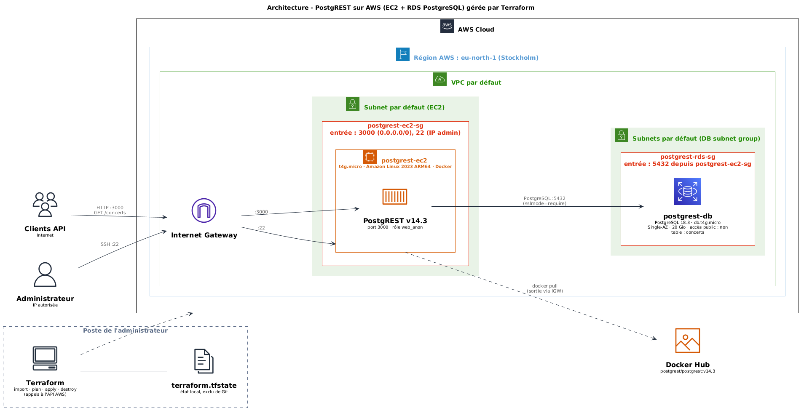

# Import et déploiement d'une infrastructure AWS avec Terraform

## 1. Présentation du projet

Ce projet consiste à importer une infrastructure AWS existante dans Terraform afin de la gérer sous forme de code (Infrastructure as Code – IaC), puis à déployer une API REST avec Docker et PostgREST.

L'infrastructure a initialement été créée manuellement depuis la console AWS. Les ressources existantes ont ensuite été importées dans Terraform afin de décrire leur configuration, d'en assurer la gestion et de vérifier la cohérence entre l'infrastructure réelle et le code.

Une API PostgREST est également déployée sur une instance EC2 et connectée à une base de données PostgreSQL hébergée sur Amazon RDS.

## 2. Architecture de l'infrastructure

L'infrastructure est déployée dans la région AWS **eu-north-1 (Stockholm)**, dans le VPC par défaut.

Les composants principaux de l'infrastructure sont :

- **Amazon EC2** : instance `t4g.micro` exécutant Amazon Linux 2023 (architecture ARM64).
- **Docker** : moteur de conteneurs installé sur l'instance EC2.
- **PostgREST** : API REST exécutée dans un conteneur Docker.
- **Amazon RDS** : base de données PostgreSQL managée, de classe `db.t4g.micro`.
- **Terraform** : import et gestion de l'infrastructure existante.
- **Groupes de sécurité AWS** : contrôle des communications réseau entre Internet, EC2 et RDS.

PostgREST expose automatiquement une API REST à partir des tables PostgreSQL autorisées.



### Flux réseau

- **Internet → EC2 (port 3000)** : accès public à l'API PostgREST.
- **IP autorisée → EC2 (port 22)** : connexion SSH réservée à l'administrateur.
- **EC2 → RDS (port 5432)** : connexion de PostgREST à la base PostgreSQL.

La base de données RDS n'est pas exposée publiquement. Son accès est autorisé uniquement depuis le groupe de sécurité de l'instance EC2.

## 3. Organisation du dépôt

```text
terraform-postgrest-aws/
│
├── terraform/
│   ├── versions.tf               # versions de Terraform et du provider AWS
│   ├── provider.tf               # configuration du provider (région)
│   ├── variables.tf              # variables d'entrée (mot de passe RDS)
│   ├── network.tf                # lecture du VPC et des subnets par défaut
│   ├── security_groups.tf        # groupes de sécurité EC2 et RDS
│   ├── security_group_rules.tf   # règles d'entrée et de sortie
│   ├── ec2.tf                    # instance EC2
│   ├── rds.tf                    # base RDS et DB subnet group
│   ├── outputs.tf                # valeurs affichées après déploiement
│   └── .terraform.lock.hcl       # versions exactes des providers
├── docs/
│   └── Architecture-aws-terraform.png
├── .gitignore
└── README.md
```

- `terraform/` contient les fichiers décrivant les ressources AWS importées.
- `docs/` contient le schéma d'architecture et son code source PlantUML.

## 4. Création et import de l'infrastructure

### 4.1 Création des ressources AWS

Les ressources ont d'abord été créées manuellement depuis la console AWS.

**Instance EC2 :**

- Nom : `postgrest-ec2`
- Type : `t4g.micro`
- Système : Amazon Linux 2023 ARM64
- VPC : VPC par défaut
- Accès SSH configuré avec une paire de clés.

**Instance RDS :**

- Identifiant : `postgrest-db`
- Moteur : PostgreSQL 18.3
- Classe : `db.t4g.micro`
- Stockage : 20 Gio
- Déploiement : Single-AZ
- Accès public : désactivé.

**Groupes de sécurité :**

- `postgrest-ec2-sg` pour l'instance EC2.
- `postgrest-rds-sg` pour la base de données RDS.

La console RDS a également créé automatiquement un **DB subnet group** (`default-vpc-00a646f36dd46c478`), qui indique à RDS dans quels subnets du VPC la base peut être placée.

### 4.2 Import avec Terraform

L'objectif est de permettre à Terraform de gérer des ressources qui existent déjà sur AWS, sans avoir à les recréer.

Après avoir défini les ressources dans les fichiers `.tf`, les commandes `terraform import` ont permis d'associer les ressources AWS à leur représentation Terraform.

Exemples :

```bash
terraform import aws_instance.postgrest i-00471d0ef5b706df3
terraform import aws_db_instance.postgrest postgrest-db
terraform import aws_db_subnet_group.default default-vpc-00a646f36dd46c478
terraform import aws_security_group.ec2 sg-0ed4fe578e44bd71d
terraform import aws_security_group.rds sg-09cb601ac0c6df79f
```

Les règles des groupes de sécurité ont également été importées individuellement, sous forme de ressources `aws_vpc_security_group_ingress_rule` et `aws_vpc_security_group_egress_rule`.

### 4.3 Ressources lues sans être gérées (data sources)

Le VPC par défaut et ses subnets existaient avant le projet et ne doivent pas être supprimés par Terraform. Ils ne sont donc pas importés, mais lus avec des **data sources** (`network.tf`) :

- `data.aws_vpc.default` : VPC par défaut de la région ;
- `data.aws_subnets.default` : subnets de ce VPC, utilisés par le DB subnet group ;
- `data.aws_subnet.ec2` : subnet par défaut de la zone de disponibilité de l'instance EC2.

Ces data sources remplacent les identifiants écrits en dur (`vpc-...`, `subnet-...`), propres à un compte AWS, et permettent de réutiliser la configuration dans un autre compte. Les valeurs obtenues étant identiques aux identifiants d'origine, ce changement n'a entraîné aucune modification de l'infrastructure.

### 4.4 Vérification de la configuration

Les commandes suivantes ont été utilisées pour contrôler la configuration Terraform :

```bash
terraform init
terraform fmt
terraform validate
terraform plan
```

- `terraform init` initialise le projet et télécharge le provider AWS.
- `terraform fmt` formate les fichiers Terraform.
- `terraform validate` vérifie la syntaxe et la cohérence de la configuration.
- `terraform plan` compare la configuration déclarée avec l'état réel de l'infrastructure.

### 4.5 Différences détectées et corrigées

Lors des vérifications avec `terraform plan`, plusieurs différences ont été observées et analysées.

**1. Descriptions des règles de sécurité**

Lors de l'import des groupes de sécurité, Terraform a récupéré les règles existantes sur AWS. Ces trois règles ne possédaient pas de description.

Dans la configuration Terraform, une description explicite a été ajoutée à chacune d'elles. Terraform a donc proposé 3 modifications, correspondant uniquement à l'ajout de ces descriptions. Elles ont été appliquées afin de rendre la configuration réseau plus lisible.

À l'inverse, le nom et la description des **groupes de sécurité** eux-mêmes ne peuvent pas être modifiés après leur création : les changer forcerait leur destruction et leur recréation. Les descriptions générées par la console (`launch-wizard-1 created ...`, `Created by RDS management console`) ont donc été conservées telles quelles.

**2. Description du DB subnet group**

Après l'import du DB subnet group, Terraform proposait de remplacer sa description `Created from the RDS Management Console` par `Managed by Terraform`.

Cette différence venait de l'absence de l'argument `description` dans le code : Terraform appliquait alors sa propre valeur par défaut. La valeur réelle d'AWS a été recopiée dans la configuration, ce qui a supprimé la différence.

**3. Évolution de l'adresse IP publique de l'instance EC2**

L'adresse IP publique de l'instance change à chaque arrêt et redémarrage, car aucune adresse Elastic IP n'est associée. Lorsque l'instance est arrêtée, elle n'a plus d'IP publique.

Terraform signale cette évolution dans la section *« Objects have changed outside of Terraform »* : il s'agit d'un écart entre l'état enregistré et la réalité, et non d'une modification à appliquer à l'infrastructure. L'état est resynchronisé, sans aucune action sur AWS, avec :

```bash
terraform apply -refresh-only
```

**4. Ajout de valeurs de sortie**

Des outputs Terraform ont été ajoutés afin de récupérer facilement les informations utiles au déploiement :

```hcl
output "ec2_public_ip" {
  description = "Adresse IP publique de l'instance EC2"
  value       = aws_instance.postgrest.public_ip
}

output "rds_endpoint" {
  description = "Adresse de la base RDS (sans le port)"
  value       = aws_db_instance.postgrest.address
}

output "api_url" {
  description = "URL de test de l'API PostgREST"
  value       = "http://${aws_instance.postgrest.public_ip}:3000/concerts?order=id.asc"
}
```

Ces modifications concernaient uniquement les valeurs de sortie Terraform et ne nécessitaient aucune modification de l'infrastructure AWS.

**5. Vérification après synchronisation**

Après analyse et synchronisation des différences identifiées, une nouvelle vérification a été effectuée avec `terraform plan`. Le résultat obtenu est :

```text
No changes. Your infrastructure matches the configuration.
```

Terraform ne détecte donc plus de modification à appliquer entre la configuration déclarée et l'infrastructure existante.


### 4.6 Différences restantes et limites de l'import

Certains éléments ne peuvent pas être récupérés par un import, ne sont volontairement pas gérés par Terraform, ou peuvent faire réapparaître des différences :

- **Mot de passe RDS** : AWS ne renvoie jamais le mot de passe administrateur. Il est fourni par la variable sensible `db_password` lors d'une recréation, et ignoré (`lifecycle { ignore_changes = [password] }`) pour la base existante afin que Terraform ne tente pas de le réécrire.
- **Arguments propres à Terraform** (par exemple `skip_final_snapshot`) : ils n'existent pas côté AWS. Leur valeur provient uniquement du code et non de l'infrastructure importée.
- **Identifiant d'AMI** : l'AMI `ami-02e73d7872fcc1b49` est propre à la région `eu-north-1` et à une version précise d'Amazon Linux 2023. Elle est conservée en dur pour refléter fidèlement l'instance importée, mais devra être adaptée pour une autre région.
- **Version du moteur PostgreSQL** : la version `18.3` est fixée dans le code. Si AWS applique une mise à jour mineure automatique, une différence apparaîtra dans le plan.
- **Adresse IP autorisée pour SSH** : elle est déclarée dans `security_group_rules.tf` et doit être adaptée à l'adresse de la personne qui déploie.
- **Paire de clés SSH** : l'instance y fait référence par son nom (`postgrest-key`), mais la paire de clés n'est pas gérée par Terraform. La clé privée n'est jamais stockée sur AWS.
- **Ressources du VPC par défaut** (VPC, subnets, Internet Gateway, tables de routage) : elles préexistaient et sont seulement lues (section 4.3), pas importées.
- **Couche applicative** : Docker, le conteneur PostgREST, la table `concerts` et le rôle `web_anon` sont configurés manuellement (section 6) et ne sont pas suivis par Terraform.

## 5. Recréer l'infrastructure

### 5.1 Prérequis

- Un compte AWS et l'AWS CLI configurée avec un profil, par exemple `aws configure --profile terraform-lab`.
- Terraform `>= 1.5.0` installé.
- Une paire de clés EC2 nommée `postgrest-key` dans la région `eu-north-1`.
- L'adresse IP autorisée pour SSH adaptée dans `security_group_rules.tf`.

### 5.2 Déploiement

Le profil AWS utilisé n'est pas écrit dans le code : il est choisi avec une variable d'environnement. Le mot de passe administrateur de la base RDS n'est pas non plus stocké dans le dépôt : il est fourni de la même manière.

```bash
export AWS_PROFILE=terraform-lab
export TF_VAR_db_password='<MOT_DE_PASSE>'
```

Puis :

```bash
git clone https://github.com/AmineJilani/terraform-postgrest-aws.git
cd terraform-postgrest-aws/terraform

terraform init
terraform plan
terraform apply
```

Une fois l'infrastructure créée, les informations utiles sont affichées avec :

```bash
terraform output
```

## 6. Déploiement de PostgREST

### 6.1 Connexion à l'instance EC2

L'adresse IP publique de l'instance est obtenue depuis le poste local avec `terraform output -raw ec2_public_ip`. La connexion s'effectue ensuite avec SSH :

```bash
ssh -i ~/.ssh/postgrest-key.pem ec2-user@<EC2_PUBLIC_IP>
```

### 6.2 Installation de Docker

Installation de Docker sur Amazon Linux 2023 :

```bash
sudo dnf install docker -y
```

Démarrage du service et activation au démarrage :

```bash
sudo systemctl enable --now docker
```

Vérification :

```bash
sudo docker run hello-world
```

### 6.3 Installation du client PostgreSQL

Le client PostgreSQL permet de se connecter à la base RDS depuis l'instance EC2.

```bash
sudo dnf install postgresql17 -y
```

L'adresse de la base est obtenue depuis le poste local avec `terraform output -raw rds_endpoint`. Connexion à la base de données :

```bash
psql "host=<RDS_ENDPOINT> port=5432 dbname=postgres user=postgres sslmode=require"
```

Le mot de passe PostgreSQL est demandé lors de la connexion.

### 6.4 Création de la table PostgreSQL

Une fois connecté à PostgreSQL, la table `concerts` est créée :

```sql
CREATE TABLE concerts (
    id integer PRIMARY KEY,
    artiste text NOT NULL,
    ville text NOT NULL
);
```

Insertion de données de test :

```sql
INSERT INTO concerts (id, artiste, ville) VALUES
    (1, 'Orelsan', 'Paris'),
    (2, 'Angèle', 'Lyon');
```

Création du rôle utilisé pour les requêtes anonymes de l'API :

```sql
CREATE ROLE web_anon NOLOGIN;
GRANT USAGE ON SCHEMA public TO web_anon;
GRANT SELECT ON TABLE concerts TO web_anon;
```

Ce rôle ne possède pas de droit de connexion direct à PostgreSQL. PostgREST l'utilise pour exécuter les requêtes API avec les seules permissions qui lui ont été accordées.

### 6.5 Déploiement du conteneur PostgREST

Récupération de l'image officielle :

```bash
sudo docker pull postgrest/postgrest:v14.3
```

Le mot de passe PostgreSQL est saisi dans une variable de session afin de ne pas l'écrire directement dans la commande ni dans l'historique du shell :

```bash
read -s -p "Mot de passe RDS postgres : " DB_PASSWORD
echo
```

Lancement du conteneur :

```bash
sudo docker run -d \
  --name postgrest \
  --restart unless-stopped \
  -p 3000:3000 \
  -e PGRST_DB_URI="postgres://postgres:${DB_PASSWORD}@<RDS_ENDPOINT>:5432/postgres?sslmode=require" \
  -e PGRST_DB_SCHEMAS="public" \
  -e PGRST_DB_ANON_ROLE="web_anon" \
  postgrest/postgrest:v14.3
```

Remplacer `<RDS_ENDPOINT>` par l'adresse réelle de l'instance RDS.

Grâce à `systemctl enable docker` et à l'option `--restart unless-stopped`, le conteneur redémarre automatiquement après un redémarrage de l'instance.

Vérification du conteneur et consultation des logs :

```bash
sudo docker ps
sudo docker logs postgrest
```

## 7. Vérification de l'API REST

PostgREST génère automatiquement une API REST à partir des tables accessibles dans le schéma PostgreSQL configuré. L'API permet ici de consulter les concerts enregistrés dans la table `concerts`.

Depuis l'instance EC2, un premier test est effectué localement :

```bash
curl "http://localhost:3000/concerts?order=id.asc"
```

Un second test est réalisé depuis une machine externe pour vérifier l'accessibilité publique de l'API :

```bash
curl "http://<EC2_PUBLIC_IP>:3000/concerts?order=id.asc"
```

Depuis le dossier `terraform/` du poste local, l'URL peut aussi être obtenue directement avec les outputs :

```bash
curl "$(terraform output -raw api_url)"
```

Résultat obtenu :

```json
[
  {"id": 1, "artiste": "Orelsan", "ville": "Paris"},
  {"id": 2, "artiste": "Angèle", "ville": "Lyon"}
]
```

La réponse JSON confirme que :

- PostgREST fonctionne sur l'instance EC2.
- La connexion entre EC2 et RDS PostgreSQL est opérationnelle.
- Les permissions du rôle `web_anon` permettent la lecture de la table.
- L'API est accessible depuis Internet.

## 8. Sécurité

Plusieurs mesures ont été mises en place :

- La base RDS n'est pas accessible publiquement (`publicly_accessible = false`).
- Le port PostgreSQL 5432 est autorisé uniquement depuis le groupe de sécurité de l'instance EC2. La règle référence un groupe de sécurité plutôt qu'une adresse IP : elle reste valable même si l'IP de l'instance change.
- L'accès SSH est limité à une adresse IP autorisée (`/32`).
- La connexion entre PostgREST et PostgreSQL est chiffrée avec SSL (`sslmode=require`).
- Le stockage de la base RDS est chiffré au repos (`storage_encrypted = true`).
- L'instance EC2 impose IMDSv2 (`http_tokens = "required"`) : l'accès au service de métadonnées nécessite un jeton de session, ce qui protège notamment contre les attaques de type SSRF.
- Aucun secret n'est écrit dans le code : le mot de passe RDS est une variable sensible et le profil AWS est choisi par variable d'environnement.
- Les fichiers sensibles et les états Terraform sont exclus du dépôt Git grâce au `.gitignore`. C'est indispensable, car le fichier `terraform.tfstate` contient le mot de passe RDS en clair.

**Limites de sécurité à connaître :**

- Pour cette démonstration, PostgREST se connecte à PostgreSQL avec le compte administrateur `postgres`, puis utilise le rôle `web_anon` pour les requêtes API. Cette configuration facilite le déploiement, mais n'est pas recommandée en production. Une amélioration consisterait à créer un compte technique dédié à PostgREST, avec uniquement les permissions nécessaires.
- Le mot de passe est transmis au conteneur par une variable d'environnement : il reste visible avec `docker inspect` pour un utilisateur ayant accès à Docker sur l'instance.
- L'API de démonstration utilise HTTP sur le port 3000. Une mise en production nécessiterait notamment HTTPS et une configuration réseau adaptée.

## 9. Nettoyage des ressources

Les ressources AWS utilisées dans ce projet peuvent consommer des crédits ou générer des coûts, même lorsque l'API n'est plus utilisée. Après les tests, il est donc nécessaire de les supprimer.

Les variables d'environnement `AWS_PROFILE` et `TF_VAR_db_password` doivent être définies, comme pour le déploiement.

Lister d'abord les ressources suivies par Terraform :

```bash
terraform state list
```

Puis examiner les suppressions qui seraient réalisées :

```bash
terraform plan -destroy
```

Après vérification et confirmation, la suppression peut être effectuée avec :

```bash
terraform destroy
```

**Attention :** cette commande supprime l'instance EC2, l'instance RDS, le DB subnet group et les groupes de sécurité gérés par Terraform. Avec `skip_final_snapshot = true`, la suppression de RDS ne crée pas de snapshot final : les données sont définitivement perdues.

La paire de clés EC2 et les ressources préexistantes seulement lues par Terraform, comme le VPC par défaut, ses subnets et son Internet Gateway, ne sont pas supprimées par cette commande.
